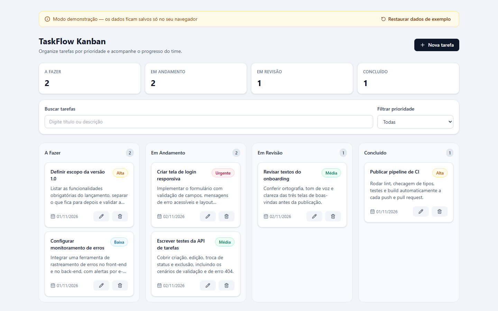
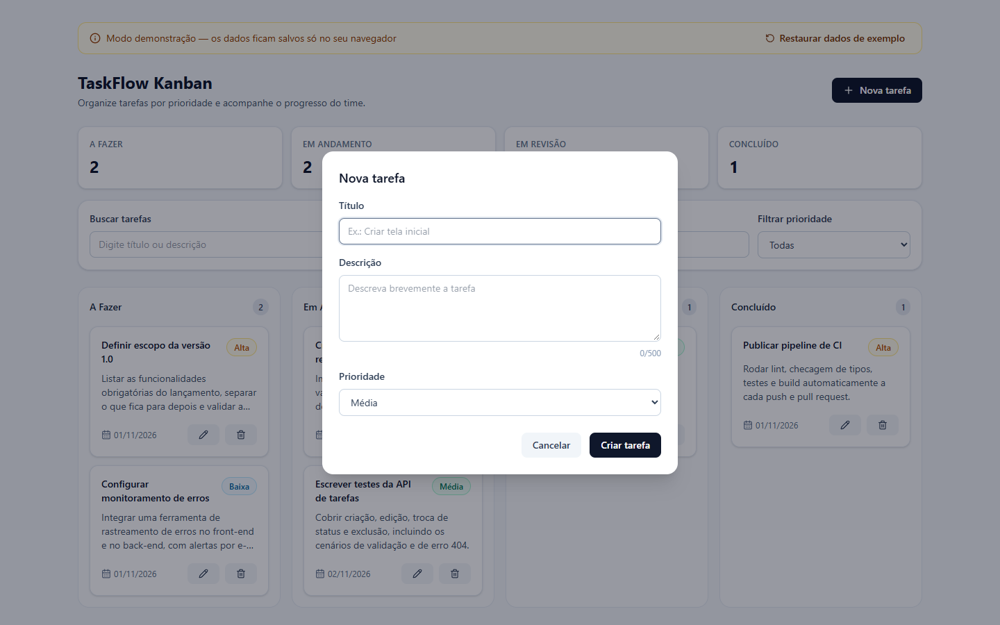

# TaskFlow Kanban

[](https://github.com/augustoemiliano/taskflow-kanban/actions/workflows/ci.yml)

Quadro Kanban full stack para organizar tarefas por **status** e **prioridade**, com arrastar e soltar, busca e filtros. Front-end (SPA em React) e back-end (API REST em Express) separados, arquitetura em camadas, persistência em **SQLite** e testes automatizados nos dois lados.

> **Objetivo:** demonstrar um fluxo completo de aplicação moderna (SPA + API REST) com validação de entrada, tratamento global de erros, UX profissional e código preparado para evoluir de persistência — o repositório é uma interface, com implementação em memória (testes) e SQLite (padrão).

## Screenshots

<!-- Adicione as imagens em docs/ e descomente as linhas abaixo. -->
<!--  -->
<!--  -->
<!--  -->

_Em breve: capturas de tela e um GIF curto do fluxo (criar, arrastar entre colunas, filtrar e excluir)._

## Funcionalidades

- CRUD completo de tarefas (título, descrição, prioridade, status)
- Quadro com 4 colunas: **A Fazer → Em Andamento → Em Revisão → Concluído**
- **Arrastar e soltar** entre colunas com mouse **e teclado** (espaço + setas), com atualização otimista e rollback automático se a API falhar
- Prioridades (Baixa, Média, Alta, Urgente) com ordenação automática
- Busca por título/descrição e filtro por prioridade
- Contadores por status
- Estados de carregamento (skeleton), erro (com "Tentar novamente") e vazio (com atalho para criar)
- Validação no formulário (com erros por campo) **e** na API (Zod)
- Confirmação antes de excluir e feedback com toasts
- Modais acessíveis (`role="dialog"`, fecham com Esc, foco gerenciado)
- Dados persistidos em SQLite (sobrevivem a reinícios da API)

## Stack

| Camada | Tecnologias |
| --- | --- |
| Front-end | React 19, TypeScript, Vite, Tailwind CSS 4, dnd-kit, Axios, React Router, react-hot-toast, lucide-react |
| Back-end | Node.js, Express 5, TypeScript, Zod, SQLite (`node:sqlite`, nativo do Node), dotenv, CORS |
| Testes | Vitest, Supertest, Testing Library (React + user-event), jsdom |
| Qualidade | ESLint (typescript-eslint, react-hooks), TypeScript `strict`, GitHub Actions |
| Infra | Docker (multi-stage), nginx, docker-compose |

## Arquitetura

```
┌──────────────────────────┐   HTTP/JSON   ┌────────────────────────────────────────────────┐
│  SPA (React + Vite)      │ ───────────▶  │  API REST (Express)                            │
│                          │               │                                                │
│  pages/DashboardPage     │               │  routes ─▶ validateRequest (Zod)               │
│  hooks/useTasks  ────────┤               │         ─▶ controller ─▶ service (regras)      │
│  services/taskService    │               │         ─▶ TaskRepository (interface)          │
│  (Axios)                 │               │              ├─ SqliteTaskRepository (padrão)  │
└──────────────────────────┘               │              └─ InMemoryTaskRepository (testes)│
                                           │  errorHandler global ─▶ resposta padronizada   │
                                           └────────────────────────────────────────────────┘
```

**Back-end (camadas)**

- `routes/` — define os endpoints e aplica o middleware de validação.
- `schemas/` — schemas Zod (título 3–100 caracteres, descrição até 500, enums de status/prioridade, UUID). Campos desconhecidos são descartados.
- `controllers/` — traduzem HTTP ⇄ serviço; não contêm regra de negócio.
- `services/` — regras de negócio (ex.: toda tarefa nasce em `TODO`, `404` quando não existe).
- `repositories/` — interface `TaskRepository` com duas implementações. A escolha é feita por `DATABASE_DRIVER`, sem alterar nenhuma outra camada.
- `errors/` — `AppError` + `errorHandler` global: validação → `400`, JSON malformado → `400`, não encontrado → `404`, inesperado → `500` (logado no servidor, sem vazar detalhes).
- `app.ts` expõe `createApp({ taskRepository, allowedOrigins })`, o que permite testar a API inteira com o repositório em memória.

**Persistência:** o SQLite usa o módulo nativo `node:sqlite` (sem dependência nativa para compilar). O schema tem `CHECK` constraints para status e prioridade, e as migrations são versionadas via `PRAGMA user_version` (basta adicionar uma nova entrada à lista em `sqliteTaskRepository.ts`). Para migrar para PostgreSQL, basta criar outra implementação de `TaskRepository`.

**Front-end:** o hook `useTasks` concentra estado, chamadas à API, filtros e atualização otimista; os componentes de UI são burros e reutilizáveis (`components/ui`). As regras de validação do formulário espelham as da API para feedback imediato — a API continua sendo a fonte da verdade.

## Como rodar

### Pré-requisitos

- **Node.js 22.13+** (necessário para o `node:sqlite`; recomendado Node 24)
- npm 10+

### Opção 1 — tudo de uma vez (recomendado)

```bash
git clone https://github.com/augustoemiliano/taskflow-kanban.git
cd taskflow-kanban
npm install      # cria backend/.env e frontend/.env a partir dos exemplos e instala back + front
npm run dev      # API em http://localhost:3333 e app em http://localhost:5173
```

Os dados ficam em `backend/data/taskflow.db` (ignorado pelo Git).

### Opção 2 — cada parte separadamente

```bash
# API
cd backend
cp .env.example .env
npm install
npm run dev          # http://localhost:3333

# Front-end (em outro terminal)
cd frontend
cp .env.example .env
npm install
npm run dev          # http://localhost:5173
```

### Opção 3 — Docker

```bash
docker compose up --build
```

App em **http://localhost:8080** (o nginx serve a SPA e faz proxy de `/api` para a API). O banco SQLite fica no volume `taskflow-data`.

### Scripts da raiz

| Comando | O que faz |
| --- | --- |
| `npm install` | Cria os `.env` e instala as dependências de back e front |
| `npm run dev` | Sobe API + front em modo desenvolvimento |
| `npm run lint` | ESLint nos dois projetos |
| `npm run typecheck` | Checagem de tipos nos dois projetos |
| `npm test` | Testes do back e do front |
| `npm run build` | Build de produção dos dois |
| `npm start` | Roda os builds (API + `vite preview` em http://localhost:4173) |
| `npm run check` | lint + typecheck + testes + build (o mesmo que a CI) |

## Testes

```bash
npm test                    # tudo
npm test --prefix backend   # 31 testes: API (Supertest) + contrato dos repositórios
npm test --prefix frontend  # 33 testes: utilitários, hook useTasks e fluxos da tela
```

- **API:** CRUD completo, validação (campos obrigatórios, limites, enums, UUID), `404`, JSON malformado, CORS e rotas inexistentes.
- **Repositórios:** a mesma suíte de contrato roda contra a implementação em memória e a SQLite, além de testes de persistência em arquivo e das `CHECK` constraints.
- **Front:** filtros/ordenação, resolução do alvo do drop, validação do formulário, mensagens de erro, atualização otimista com rollback e fluxos de criar/editar/excluir/filtrar renderizando a página.

## Variáveis de ambiente

### `backend/.env`

| Variável | Padrão | Descrição |
| --- | --- | --- |
| `PORT` | `3333` | Porta HTTP |
| `NODE_ENV` | `development` | `development`, `test` ou `production` |
| `FRONTEND_URL` | `http://localhost:5173` (fora de produção) | Origens liberadas no CORS, separadas por vírgula. **Obrigatória em produção.** |
| `DATABASE_DRIVER` | `sqlite` (`memory` quando `NODE_ENV=test`) | `sqlite` (persistente) ou `memory` (volátil) |
| `DATABASE_PATH` | `data/taskflow.db` | Caminho do arquivo SQLite (ou `:memory:`) |

### `frontend/.env`

| Variável | Padrão | Descrição |
| --- | --- | --- |
| `VITE_API_URL` | `http://localhost:3333/api` em dev, `/api` no build | URL base da API (inclui `/api`) |

## Endpoints da API

Base: `http://localhost:3333/api`

| Método | Rota | Descrição | Sucesso |
| --- | --- | --- | --- |
| GET | `/health` | Health check | `200` |
| GET | `/tasks` | Lista tarefas (mais recentes primeiro) | `200` |
| GET | `/tasks/:id` | Busca por ID | `200` |
| POST | `/tasks` | Cria tarefa (`title`, `priority`, `description?`) — status inicial `TODO` | `201` |
| PATCH | `/tasks/:id` | Atualiza parcialmente (`title?`, `description?`, `priority?`, `status?`) | `200` |
| PATCH | `/tasks/:id/status` | Atualiza apenas o status (usado no arrastar e soltar) | `200` |
| DELETE | `/tasks/:id` | Remove tarefa | `200` |

Valores aceitos — `status`: `TODO`, `IN_PROGRESS`, `REVIEW`, `DONE` · `priority`: `LOW`, `MEDIUM`, `HIGH`, `URGENT`.

### Formato das respostas

Sucesso:

```json
{ "success": true, "data": { "id": "…", "title": "Criar layout", "status": "TODO", "priority": "HIGH", "description": "", "createdAt": "…", "updatedAt": "…" } }
```

Erro:

```json
{
  "success": false,
  "error": {
    "code": "VALIDATION_ERROR",
    "message": "Existem campos inválidos na requisição.",
    "details": [{ "field": "title", "message": "O título deve ter no mínimo 3 caracteres." }]
  }
}
```

Códigos de erro: `VALIDATION_ERROR` (400), `INVALID_JSON` (400), `TASK_NOT_FOUND` (404), `RESOURCE_NOT_FOUND` (404), `PAYLOAD_TOO_LARGE` (413), `INTERNAL_SERVER_ERROR` (500).

### Exemplos (curl)

```bash
curl -X POST http://localhost:3333/api/tasks \
  -H "Content-Type: application/json" \
  -d '{"title":"Criar layout","description":"Kanban","priority":"HIGH"}'

curl http://localhost:3333/api/tasks

curl -X PATCH http://localhost:3333/api/tasks/<id>/status \
  -H "Content-Type: application/json" \
  -d '{"status":"DONE"}'
```

## Estrutura de pastas

```
taskflow-kanban/
├── .github/workflows/ci.yml   # lint + typecheck + testes + build (Node 22 e 24)
├── backend/
│   ├── src/
│   │   ├── config/            # env (validado com Zod) e CORS
│   │   ├── controllers/
│   │   ├── dtos/
│   │   ├── errors/            # AppError + errorHandler global
│   │   ├── middlewares/       # validateRequest, notFound
│   │   ├── models/
│   │   ├── repositories/      # interface + memória + SQLite
│   │   ├── routes/
│   │   ├── schemas/           # Zod
│   │   ├── services/
│   │   ├── app.ts             # createApp() (injeção de dependências)
│   │   └── server.ts
│   ├── tests/
│   └── Dockerfile
├── frontend/
│   ├── src/
│   │   ├── components/        # kanban/ e ui/
│   │   ├── hooks/useTasks.ts
│   │   ├── pages/
│   │   ├── services/          # Axios
│   │   └── utils/
│   ├── nginx.conf
│   └── Dockerfile
├── scripts/setup.mjs
├── docker-compose.yml
└── package.json               # scripts que orquestram back + front
```

## Próximos passos

- Ordenação manual dos cartões dentro da coluna (campo `position`)
- Autenticação (JWT) e quadros por usuário
- Múltiplos quadros e colunas personalizáveis
- PostgreSQL como nova implementação de `TaskRepository`
- Testes end-to-end (Playwright) na CI
- Documentação OpenAPI/Swagger

## Licença

[MIT](LICENSE)
